<div align="center">



</div>


</td>
<td width="66%" valign="top">

✦ About me

```javascript
const ahlem = {
  role: "IT Student",
  interests: [
    "Web Development",
    "Software Design",
    "Creative Projects"
  ],
  learning: [
    "Building useful applications",
    "Writing cleaner code",
    "Exploring new technologies"
  ],
  mindset: "Learn. Build. Improve."
};
```

<div align="center">

</div>

</td>
</tr>
</table>

────────

✦ Tech Stack

<p align="center">
  <strong>Languages</strong><br>
  
</p>

<p align="center">
  <strong>Frameworks & Libraries</strong><br>
  
</p>

<p align="center">
  <strong>Databases & Tools</strong><br>
  
</p>

<p align="center">
  <strong>Design & Creative Tools</strong><br>
  
</p>

<p align="center">
  <strong>Other Technologies</strong><br>
  
</p>

────────

✦ GitHub Analytics

<div align="center">


</div>

────────


<div align="center">

“Somewhere between a curious mind and a creative soul.”


</div>
